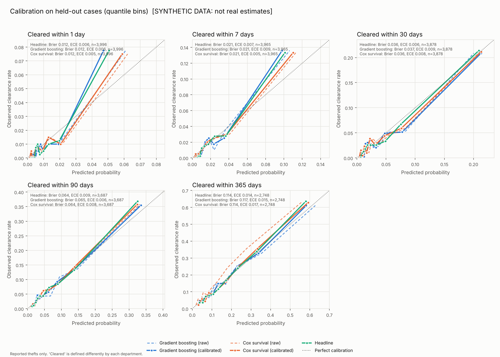
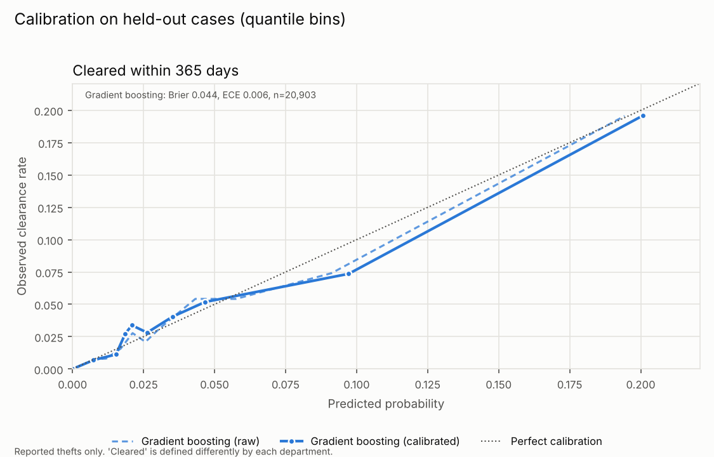

# Solvability Engine

A retrospective analyzer for **reported property-theft cases**. It estimates the
probability that a case is **cleared** within 1, 7, 30, 90 and 365 days, and lists
the factors that pushed the estimate up or down. It is trained only on public
records.

```
$ solvability predict --model artifacts/model.pkl --set item=bicycle value=900 location=street_parking report_delay=2

P(case cleared within ...)
     1 days    0.4%     (Cox survival model:   0.1%)
    30 days    0.6%     (Cox survival model:   0.4%)
   365 days    3.3%     (Cox survival model:   3.5%)

Top factors at 90 days, compared with a typical reported case:
    -1.4 pts  location type: street_parking (typical: retail_commercial) | hazard x0.57
    -0.5 pts  time to report: 2 (typical: 0) | hazard x0.80
    ...
Caveats
  - Only REPORTED thefts are in the data. ...
  - 'Cleared' means different things in different places. ...
```
*(Output from a model trained on synthetic demo data. The numbers are illustrative.)*

## Quick start

```bash
pip install -e '.[dev]'

# 1. Try it with synthetic data (labelled SYNTHETIC in every output)
solvability synth --n 20000 --out data/synth.csv
solvability train --data synthetic=data/synth.csv --out artifacts/model.pkl

# 2. Real data: open-data portals (downloaded through the Socrata API)
solvability fetch chicago --since 2023-01-01 --until 2024-01-01 --out data/raw/chicago.csv
solvability fetch la      --since 2022-01-01 --until 2023-01-01 --out data/raw/la.csv
solvability train --data chicago=data/raw/chicago.csv --data la=data/raw/la.csv \
                  --out artifacts/real.pkl --plot artifacts/calibration_real.png

# 3. FBI NIBRS (has clearance DATES, so it supports the full time curve):
#    download a state's NIBRS CSV bundle from the FBI Crime Data Explorer
#    (Documents & Downloads), unzip it into a folder, then
solvability train --data nibrs=data/nibrs/XX-2022 --data chicago=data/raw/chicago.csv

pytest
```

## Ask it questions

All inputs describe the **reported case**. Unknown fields are left blank and the
model treats them as "not recorded".

| field (aliases) | meaning |
|---|---|
| `loss_value` (`value`) | total value stolen, $ |
| `item_category` (`item`) | vehicle, vehicle_parts_contents, bicycle, electronics, cash_cards, jewelry_precious, tools_equipment, retail_merchandise, personal_items, household, other |
| `location_type` (`location`) | residence, street_parking, retail_commercial, vehicle, transit, school_govt, hotel_lodging, other |
| `days_to_report` (`report_delay`) | days between the theft and the report |
| `has_footage` (`footage`), `has_witness` (`witness`), `has_plate_read` (`plate`) | evidence flags: yes / no |
| `insider` | employee/employer involvement |
| `pattern_count` (`similar_recent`) | similar thefts in the same area in the prior 14 days |
| `offender_count` (`offenders`), `victim_type` (`victim`), `jurisdiction` (`city`) | |

```bash
# What would have changed the odds?
solvability whatif --model M --set item=bicycle value=900 location=street_parking report_delay=2 \
   --scenario "reported same day: report_delay=0" \
   --scenario "neighbour had a camera: footage=yes" \
   --scenario "camera + plate read: footage=yes,plate=yes"

# How much does reporting quickly matter?
solvability whatif --model M --set item=electronics value=1200 location=residence \
   --sweep report_delay=0,1,3,7,30,90

# It's been 3 weeks. What are the odds now, and when should I file the insurance claim?
solvability wait --model M --set item=bicycle value=900 location=street_parking --window 30

# Model card + Cox hazard ratios
solvability info --model M
```

`wait` computes **conditional** probabilities:
P(cleared in the next *k* days | still open after *w* days). It also reports the day
after which the remaining one-year chance drops below 2%: a reasonable point to stop
waiting and replace the item or claim insurance.

Every command takes `--json` for machine-readable output.

### Scope of hypotheticals

The levers are facts a victim, insurer, or reader could know about a reported case:
what was taken, where, how quickly it was reported, what evidence exists, and how long
it has been open. The engine deliberately has **no offender-side inputs**, such as
when or how stolen goods are sold or how long someone waits before selling. None of
the source data records this. A tool that optimises those choices would be a guide
to avoiding detection, not a solvability analyzer. Unknown fields are rejected
with an error.

## How it works

```
loader ─► cleaning ─► feature builder ─► Cox PH (time-to-clearance, censoring-aware)
                                        └► gradient boosting per horizon
                                              │
                         held-out calibration (Platt / isotonic) per model per horizon
                                              │
                    headline = blend ─► probability curve + top factors + caveats
```

| module | role |
|---|---|
| `solvability/data/loader.py` | NIBRS / Chicago / LA / canonical-CSV loaders → one canonical schema; portal fetcher |
| `solvability/data/mappings.py` | keyword maps from source descriptions to item / location / victim categories |
| `solvability/data/synthetic.py` | synthetic cases with known effects (demo + tests) |
| `solvability/cleaning.py` | validation, deduplication, outlier handling, `pattern_count` derivation, horizon labelling, news guard |
| `solvability/features.py` | log-scaled numerics, one-hot categoricals, tri-state flags with *unknown* indicators |
| `solvability/models/cox.py` | numpy Cox PH: Breslow ties, ridge penalty, jurisdiction strata, Harrell's C |
| `solvability/models/engine.py` | GBM per horizon, calibration, blend, curve, explanations, save/load |
| `solvability/evaluation.py` | Brier, AUC, ECE, C-index, per-jurisdiction calibration, calibration plot |
| `solvability/whatif.py` | hypothetical cases, scenarios, sweeps, wait analysis, input warnings |
| `solvability/cli.py` | `synth`, `fetch`, `train`, `evaluate`, `predict`, `whatif`, `wait`, `info` |

**Censoring.** A case still open on the as-of date is right-censored. The Cox model
counts it in every risk set up to its follow-up time. The per-horizon classifiers
drop it at horizons beyond its follow-up instead of calling it "not cleared".

**Sources that record only *whether* a case cleared** (Chicago's `arrest` flag,
LAPD's `status`) have no clearance date. They are labelled only at the 365-day
horizon, and only for cases followed for at least a year. Labelling them at shorter
horizons would silently turn late clearances into "not cleared". A model trained only
on such sources answers the 365-day question and says so. The full curve and `wait`
need NIBRS or canonical data with clearance dates.

**Jurisdiction.** The Cox baseline hazard is stratified by jurisdiction, because each
department records "cleared" its own way. Evaluation prints observed vs. predicted
clearance by jurisdiction, so you can see where a pooled model fits poorly.

**Calibration.** Each model is calibrated separately at each horizon on a held-out
calibration split: isotonic regression when there are ≥20k rows and ≥500 clearances,
otherwise Platt scaling, which stays smooth for what-if sweeps. Cumulative
probabilities are forced to be non-decreasing over time. The headline is the mean of
the calibrated Cox and GBM estimates (`--headline gbm|cox|blend`).

**Top factors.** Each field is swapped, one at a time, for its value in a *typical
reported case*, and the change in the headline probability is reported. A field
that is mostly unrecorded has "unknown" as its typical value. Where the Cox model is
fitted, each factor also shows its hazard multiplier against the training average.

**Fields the model can't speak to.** Public portals rarely record footage, witnesses
or plate reads. If training data never shows a flag both ways, setting it in a
hypothetical is *ignored, with a warning*. The tool will not invent an effect it never
observed. Inputs outside the training range are flagged as extrapolation.

## Results so far

| data | horizons | held-out AUC | ECE |
|---|---|---|---|
| Synthetic, 20k cases (known effects) | 1–365 d | 0.80–0.85 | ≤ 0.015 |
| Chicago 2023 + LAPD 2022, ~105k theft records | 365 d only | 0.77 | 0.006 |

On synthetic data the Cox model recovers the planted effects. For example, insider
involvement shows a hazard ratio of 4.8 against a true 4.95, and a plate read 3.7
against a true 3.67.




## Caveats (printed with every prediction)

- **Only reported thefts are in the data.** Unreported thefts are missing, and
  reporting is selective, so rates describe reported cases.
- **"Cleared" varies by department**: arrest vs. exceptional clearance, update lag,
  multi-incident clearances. Compare jurisdictions cautiously.
- **Clearance is not conviction**, and not recovery of property.
- **Rates for groups of similar cases**, not a forecast for a specific case or person.
- **Never validate on news stories.** Solved cases get more coverage. `evaluate`
  refuses rows whose source looks like news or media, and `train` refuses them unless
  `--allow-news-training` is given (they are still kept out of the test set).
- Source-specific notes (NIBRS snapshot censoring, Chicago/LA timing gaps, synthetic
  data) are added automatically according to what the model was trained on.

## Notes

- `lifelines` doesn't build on Python 3.13, so the Cox model is a small numpy
  implementation. Tests check it against simulated ground truth and check the
  C-index against a brute-force count.
- Model files are pickles. Only load ones you made yourself.
- NIBRS column names are matched case-insensitively. Offense codes kept: 23A–23H
  (larceny), 240 (motor-vehicle theft), 220 (burglary). Robbery, fraud and
  stolen-property receiving are excluded.
