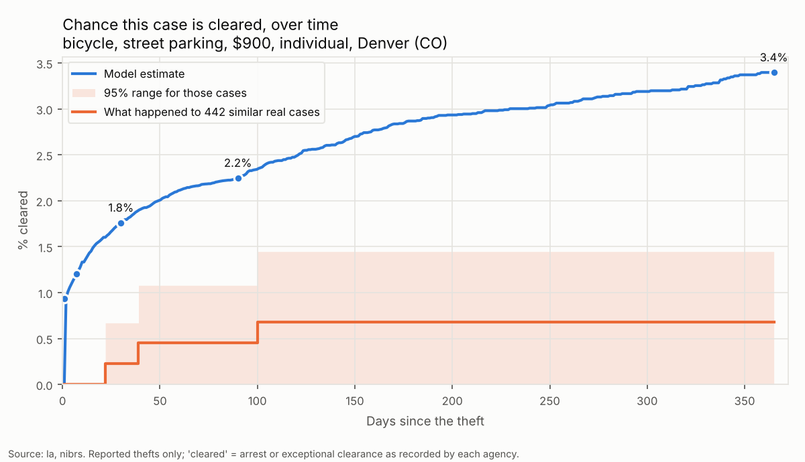
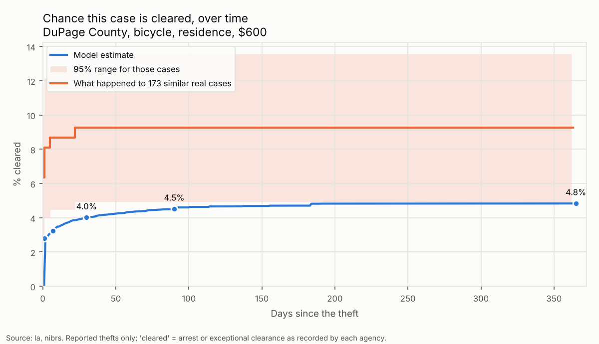
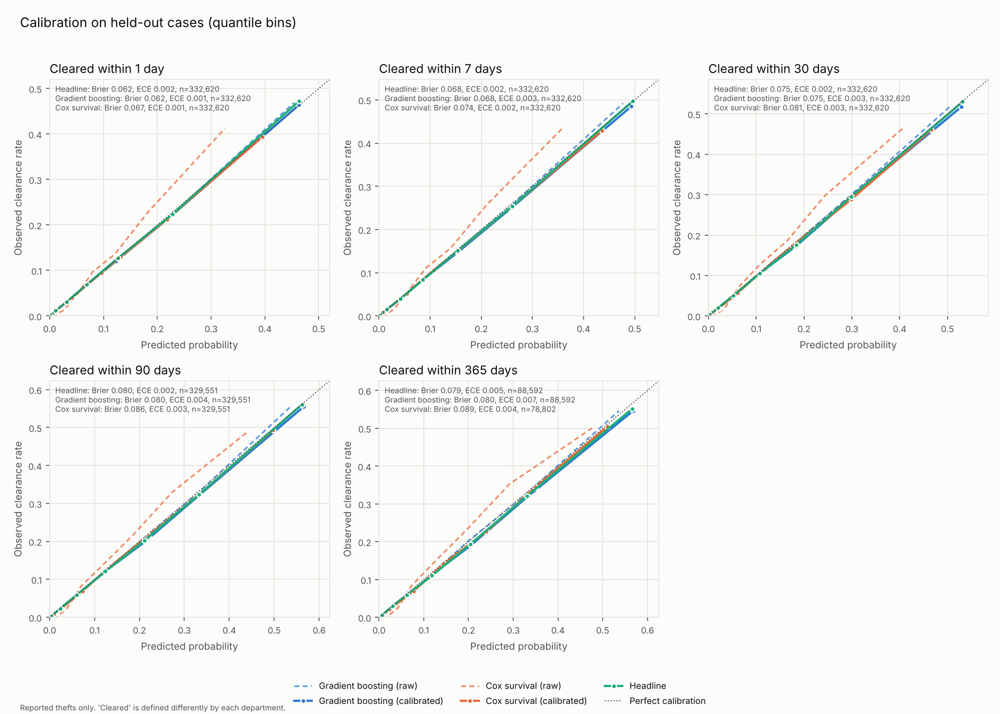

# Solvability Engine

A retrospective analyzer for **reported property-theft cases**. It estimates the
probability that a case is **cleared** within 1, 7, 30, 90 and 365 days, shows what
actually happened to similar real cases, and lists which answers moved the estimate.

**The data is real.** The model is trained on **1.71 million reported thefts**: FBI
NIBRS incidents from Illinois (including Chicago and all 39 DuPage County agencies),
Colorado, Virginia, Michigan, Washington and Vermont (2022–2024), plus Los Angeles
(2022) open-data records. A synthetic
generator exists only for tests and demos, and anything trained on it is labelled
SYNTHETIC.

```
$ solvability ask --model artifacts/real.pkl --plot case.png
What was stolen?
   ...
Case: item_category=bicycle, location_type=street_parking, loss_value=900.0,
      victim_type=individual, jurisdiction=co denver

P(case cleared within ...)
              model   similar real cases
     1 days    0.9%                 0.0%
    30 days    1.8%                 0.2%
    90 days    2.2%                 0.5%
   365 days    3.4%                 0.7%
  Similar real cases: 442 reported thefts (nibrs 442; 2023–2024) matching item category
    = bicycle; location type = street parking; victim type = individual; jurisdiction =
    co denver; value $450–$1,800.

What moves the estimate at 90 days (each answer vs. not knowing it):
    -3.6 pts  item category: bicycle
    -1.6 pts  jurisdiction: co denver
    -0.6 pts  location type: street_parking
Caveats
  - Only REPORTED thefts are in the data. ...
  - 'Cleared' means different things in different places. ...
```



## Quick start

```bash
pip install -e '.[dev]'

# Build the real-data model: downloads FBI NIBRS (IL CO VA MI WA VT) + LA, then
# trains (~15 min, ~3 GB disk). Set STATES="TX OH" etc. to choose states.
scripts/build_real_model.sh

# Ask about a theft (interactive). --plot saves a slide-ready chart.
solvability ask --model artifacts/real.pkl --plot case.png

pytest            # statsmodels (dev extra) enables the independent Cox cross-check
```

Individual steps:

```bash
solvability fetch nibrs --state CO VA --years 2023 2024 --out data/raw/nibrs    # FBI Crime Data Explorer
solvability fetch chicago --since 2023-01-01 --until 2024-01-01 --out data/raw/chicago.csv
solvability fetch la      --since 2022-01-01 --until 2023-01-01 --out data/raw/la.csv
solvability train --data nibrs=data/raw/nibrs --data la=data/raw/la.csv --out artifacts/real.pkl
# (Chicago is in Illinois NIBRS, with clearance dates; the Chicago portal loader is
#  still available for portal-only analyses, but don't combine the two: double counting)
solvability synth --out data/synth.csv     # synthetic demo data, tests only
```

## DuPage County (or any county)

Illinois reports to NIBRS, so every DuPage police agency is in the data with
clearance dates: about 21,000 thefts in 2023–2024 across 38 agencies (Naperville,
Wheaton, Lombard, Downers Grove, Elmhurst, the Sheriff, ...). `county=` narrows the
real cases used for unanswered questions and for the "similar real cases" comparison.
`ask` starts with the county question.

```bash
solvability predict --model artifacts/real.pkl --set county=DuPage item=bicycle location=residence value=600 --plot dupage.png
solvability whatif  --model artifacts/real.pkl --set county=DuPage item=electronics value=1200 location=residence \
   --scenario "Naperville PD: agency=il naperville" --scenario "Lombard PD: agency=il lombard"
```



Accuracy on **held-out DuPage cases** (4,378 the model never saw):

| cleared within | observed | predicted | AUC |
|---|---|---|---|
| 1 day | 13.2% | 13.8% | 0.85 |
| 30 days | 15.7% | 16.7% | 0.84 |
| 90 days | 16.5% | 17.9% | 0.84 |
| 365 days | 18.6% | 20.1% | 0.83 |

Agencies (90 days, observed vs predicted): Naperville 13.6% vs 12.6%, Bolingbrook
14.5% vs 14.5%, St. Charles 26.8% vs 27.4%, Elmhurst 31.2% vs 29.5%, Lombard 35.4%
vs 38.8%, Oak Brook 45.6% vs 49.5%. The model runs about 1–1.5 points high for
DuPage overall. DuPage's training-period rate (17.2% at 90 days) falls between the
held-out rate and the prediction, so part of the gap is sampling.
Agencies that straddle county lines (Aurora, Bolingbrook, St. Charles) are counted
whole. Their records don't say which side of the line a theft happened on.

## Which inputs the real data supports

The engine only asks about, and only learns from, what the source records hold.

| input | FBI NIBRS | Chicago portal | LA portal |
|---|---|---|---|
| clearance **date** (time curve) | yes | no (arrested yes/no) | no (status only) |
| item category | yes (property type) | from offense description | from offense description |
| loss value | yes | no (only $500 bands) | no |
| location type | yes | yes | yes |
| victim type | yes | retail only | inferred |
| days to report | no | no | yes |
| similar recent thefts nearby | derived | derived | derived |
| agency (jurisdiction) | yes | Chicago PD | LAPD |
| county | yes (from FBI agency list) | Cook | Los Angeles |
| insider (employee/employer) | sparse | no | embezzlement only |
| footage / witnesses / plate reads | **no** | **no** | **no** |

No public dataset records footage, witnesses or plate reads, so a model trained on
public data can't estimate their effect and `ask` doesn't ask about them. They become
usable if you train on an agency export that records them (`canonical` CSV).

`solvability ask` walks through the answerable questions, shows how many real cases
sit behind each option, and prints the model estimate **next to what actually
happened to similar real cases**. These are matched on the answers given, with
outcomes computed by Kaplan–Meier so cases still open count correctly.
`--plot case.png` saves a chart for slides.

## Ask it questions

All inputs describe the **reported case**. Unknown fields are left blank and the
model treats them as "not recorded".

| field (aliases) | meaning |
|---|---|
| `loss_value` (`value`) | total value stolen, $ |
| `item_category` (`item`) | vehicle, vehicle_parts_contents, bicycle, electronics, cash_cards, jewelry_precious, tools_equipment, retail_merchandise, personal_items, household, other |
| `location_type` (`location`) | residence, street_parking, retail_commercial, vehicle, transit, school_govt, hotel_lodging, other |
| `days_to_report` (`report_delay`) | days between the theft and the report |
| `has_footage` (`footage`), `has_witness` (`witness`), `has_plate_read` (`plate`) | evidence flags: yes / no |
| `insider` | employee/employer involvement |
| `pattern_count` (`similar_recent`) | similar thefts in the same area in the prior 14 days |
| `offender_count` (`offenders`), `victim_type` (`victim`), `jurisdiction` (`city`) | |

```bash
# What would have changed the odds?
solvability whatif --model M --set item=bicycle value=900 location=street_parking report_delay=2 \
   --scenario "reported same day: report_delay=0" \
   --scenario "neighbour had a camera: footage=yes" \
   --scenario "camera + plate read: footage=yes,plate=yes"

# How much does reporting quickly matter?
solvability whatif --model M --set item=electronics value=1200 location=residence \
   --sweep report_delay=0,1,3,7,30,90

# It's been 3 weeks. What are the odds now, and when should I file the insurance claim?
solvability wait --model M --set item=bicycle value=900 location=street_parking --window 30

# Model card + Cox hazard ratios
solvability info --model M
```

`wait` computes **conditional** probabilities:
P(cleared in the next *k* days | still open after *w* days). It also reports the day
after which the remaining one-year chance drops below 2%: a reasonable point to stop
waiting and replace the item or claim insurance.

Every command takes `--json` for machine-readable output.

### Scope of hypotheticals

The levers are facts a victim, insurer, or reader could know about a reported case:
what was taken, where, how quickly it was reported, what evidence exists, and how long
it has been open. The engine deliberately has **no offender-side inputs**, such as
when or how stolen goods are sold or how long someone waits before selling. None of
the source data records this. A tool that optimises those choices would be a guide
to avoiding detection, not a solvability analyzer. Unknown fields are rejected
with an error.

## How it works

```
loader ─► cleaning ─► feature builder ─► Cox PH (time-to-clearance, censoring-aware)
                                        └► gradient boosting per horizon
                                              │
                         held-out calibration (Platt / isotonic) per model per horizon
                                              │
        headline = best of GBM / Cox / blend per horizon ─► probability curve
           + similar real cases (Kaplan–Meier) + answer effects + caveats
```

| module | role |
|---|---|
| `solvability/data/loader.py` | NIBRS / Chicago / LA / canonical-CSV loaders → one canonical schema; portal fetcher |
| `solvability/data/mappings.py` | keyword maps from source descriptions to item / location / victim categories |
| `solvability/data/synthetic.py` | synthetic cases with known effects (demo + tests) |
| `solvability/cleaning.py` | validation, deduplication, outlier handling, `pattern_count` derivation, horizon labelling, news guard |
| `solvability/features.py` | log-scaled numerics, one-hot categoricals, tri-state flags with *unknown* indicators |
| `solvability/models/cox.py` | numpy Cox PH: Breslow ties, ridge penalty, jurisdiction strata, Harrell's C |
| `solvability/models/engine.py` | GBM per horizon, calibration, headline selection, curve, save/load |
| `solvability/evidence.py` | similar-real-case lookup, Kaplan–Meier with 95% band |
| `solvability/evaluation.py` | Brier, AUC, ECE, C-index, per-jurisdiction calibration, calibration plot |
| `solvability/whatif.py` | answers → real-case population, scenarios, sweeps, wait analysis, input warnings |
| `solvability/cli.py` | `fetch`, `train`, `evaluate`, `ask`, `predict`, `whatif`, `wait`, `info`, `synth` |

**Censoring.** A case still open on the as-of date is right-censored. The Cox model
counts it in every risk set up to its follow-up time. The per-horizon classifiers
use a case at a horizon only if it was followed for that long, cleared or not.
Counting quick clearances from short-follow-up cases while dropping their uncleared
neighbours would inflate the rate. NIBRS annual files include updates until about the
following March, so 365-day labels come from January–March incidents.

**Sources that record only *whether* a case cleared** (Chicago's `arrest` flag,
LAPD's `status`) have no clearance date. They are labelled only at the 365-day
horizon, and only for cases followed for at least a year. Labelling them at shorter
horizons would silently turn late clearances into "not cleared". A model trained only
on such sources answers the 365-day question and says so. In a mixed model, Chicago
and LA get only a 365-day estimate, and the other agencies get the full curve.

**Jurisdiction.** Every agency with 200+ thefts gets its own Cox baseline hazard
(stratum), because each department records "cleared" its own way. Gradient boosting
gets each agency's Cox baseline at 7/90/365 days as inputs. That describes how the
agency itself clears cases *with case mix held fixed*, so a mall-heavy suburb's
shoplifting isn't counted twice. Smaller agencies are pooled. A final local
recalibration uses held-out calibration cases to shrink each agency's
observed/expected ratio toward 1 and apply it. Small agencies are grouped by
county for this step. Evaluation prints observed vs. predicted
clearance by jurisdiction, so you can see where a pooled model fits poorly.

**Calibration.** Each model is calibrated separately at each horizon on a held-out
calibration split: isotonic regression when there are ≥20k rows and ≥500 clearances,
otherwise Platt scaling, which stays smooth for what-if sweeps. Cumulative
probabilities are forced to be non-decreasing over time. For each horizon the
headline is whichever of GBM, Cox or their mean scores best on the calibration data
(`--headline auto|gbm|cox|blend`).

**"Don't know" answers.** A skipped question is not treated as the recorded category
"unknown". Instead the engine draws 400 real cases that match the answers given,
applies the answers, and averages the predictions. The rest of each case (value,
agency, local theft pattern, ...) comes from real records like it.

**What moves the estimate.** For each answer, the engine compares the estimate with
and without it. The difference, in percentage points, is how much knowing that
answer changes the picture.

**Similar real cases.** Beside the model, `ask`/`predict` look up real training cases
that match the answers (item, location, victim, agency, value within ×2, report delay).
If fewer than 100 match, criteria are relaxed one at a time, and the output says
which. Their outcome curve is computed with Kaplan–Meier, so cases still open count
correctly, and the chart shades a 95% band. Small groups are noisy, and the band shows
it.

**Fields the model can't speak to.** Public portals rarely record footage, witnesses
or plate reads. If training data never shows a flag both ways, setting it in a
hypothetical is *ignored, with a warning*. The tool will not invent an effect it never
observed. Inputs outside the training range are flagged as extrapolation.

## Results on real data

Held-out test set of 342,410 real reported thefts that the model never saw (random
20% split). Calibration error (ECE) is the average gap between predicted and observed
clearance rates.

| cleared within | cases | observed | predicted | AUC | ECE |
|---|---|---|---|---|---|
| 1 day | 332,620 | 9.4% | 9.3% | 0.90 | 0.002 |
| 7 days | 332,620 | 10.4% | 10.6% | 0.90 | 0.002 |
| 30 days | 332,620 | 11.8% | 12.0% | 0.89 | 0.002 |
| 90 days | 329,551 | 12.9% | 13.2% | 0.89 | 0.002 |
| 365 days | 88,592 | 12.7% | 13.2% | 0.89 | 0.005 |

(The 365-day row covers only NIBRS cases from January–March, the only ones followed for
a full year, plus LA, which clears about 6% of thefts.)

- Time-to-clearance concordance: 0.88 headline, 0.82 Cox alone.
- **Calibrated within agencies** (365 days, observed vs predicted): Chicago 4.4% vs
  4.8%, LA 5.7% vs 5.5%, Denver 8.2% vs 8.7%, Seattle 3.7% vs 4.0%, Fairfax County VA
  29.7% vs 30.5%. For DuPage, see above.
- The gradient-boosting model beat Cox and the blend on held-out calibration data at
  every horizon, so it supplies the headline. Cox is still reported, drives the curve
  shape between horizons, and gives hazard ratios (`solvability info`).
- Full metrics: `docs/metrics_real.json`. Calibration plot: below.
- The numpy Cox model matches statsmodels' independent implementation to 1e-4
  (`tests/test_cox.py`).



## Caveats (printed with every prediction)

- **Only reported thefts are in the data.** Unreported thefts are missing, and
  reporting is selective, so rates describe reported cases.
- **"Cleared" varies by department**: arrest vs. exceptional clearance, update lag,
  multi-incident clearances. Compare jurisdictions cautiously.
- **Clearance is not conviction**, and not recovery of property.
- **Rates for groups of similar cases**, not a forecast for a specific case or person.
- **Never validate on news stories.** Solved cases get more coverage. `evaluate`
  refuses rows whose source looks like news or media, and `train` refuses them unless
  `--allow-news-training` is given (they are still kept out of the test set).
- Source-specific notes (NIBRS snapshot censoring, Chicago/LA timing gaps, synthetic
  data) are added automatically according to what the model was trained on.

## Notes

- `lifelines` doesn't build on Python 3.13, so the Cox model is a small numpy
  implementation. Tests check it against statsmodels, simulated ground truth, and a
  brute-force C-index.
- **No outcome leakage.** NIBRS offender details (count, age, sex) are filled in
  mostly after an arrest, so they are not used as inputs. Recovered property is
  excluded from the loss value, and attempted thefts are dropped.
- Model files are pickles. Only load ones you made yourself.
- NIBRS column names are matched case-insensitively. Offense codes kept: 23A–23H
  (larceny), 240 (motor-vehicle theft), 220 (burglary). Robbery, fraud and
  stolen-property receiving are excluded.
